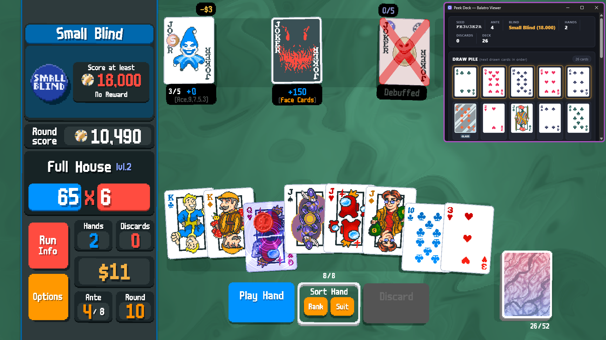

# Balatro Peek Relay & Viewer

A lightweight Balatro companion tool: a **Steamodded Lua bridge mod** paired with a standalone **Go + Webview desktop viewer** (built with [MyGO](https://github.com/egoist/mygo)). Shows real-time draw pile queue, current hand, game stats, and renders native Balatro card sprites with enhancements, seals, and edition shaders.



---

## Features

- **Draw Order Peek**: Displays remaining draw pile in exact draw order (the next 5 cards are prominently highlighted).
- **Native Sprites**: Renders cards using authentic Balatro sprite textures (`8BitDeck.png`, `Enhancers.png`).
- **Modifiers Support**:
  - **Enhancements**: Bonus, Mult, Wild, Glass, Steel, Stone, Gold, Lucky.
  - **Seals**: Gold, Red, Blue, Purple (accurate seal stamp overlay).
  - **Editions**: Holographic, Foil, Polychrome, Negative (animated CSS shader overlays).
- **HUD Strip**: Displays current Seed, Ante, Blind & target chips, Hands left, Discards left, and remaining Deck size.
- **Ultra-low Resource Footprint**:
  - **Desktop App**: ~10 MB RAM usage.
  - **Lua Relay Mod**: ~27.5 MB in-game overhead.
- **Zero-lag File IPC**: Mod throttles writes to prevent disk thrashing; desktop app watches via SHA-256 hash checks every 200ms.

---

## Installation & Setup

### 1. Install the Lua Mod
1. Install [Steamodded](https://github.com/SteamopolliS/Steamodded) for Balatro.
2. Copy the `mod/` directory into your Balatro mods folder:
   ```
   %AppData%\Balatro\Mods\PeekRelay\
   ├── metadata.json
   └── main.lua
   ```
3. Launch Balatro. The mod will automatically write `live_deck.json` inside the same folder during any run.

### 2. Run the Desktop App
Download or run the standalone binary:
```
app/build/windows-amd64/PeekDeck.exe
```
Or run the installer (`PeekDeck Setup 1.0.0 amd64.exe`). No Node.js or runtime dependencies required.

---

## Development

Requirements:
- Go 1.27+
- [Bun](https://bun.sh/) (or Node 20+)

### Start Dev Server (Live Reload)
```sh
cd app
bun install
bun run dev
```

### Build Standalone Binary
```sh
cd app
bun run build
```
Output will be placed in `app/build/windows-amd64/PeekDeck.exe`.

---

## License

MIT
